# ERD — Sistem Informasi UKM Fotografi Universitas Pancasila (PhotoUP 94)

Diagram di bawah dibuat dari migrasi di `database/migrations` dan hanya memuat tabel data aplikasi.
Tabel bawaan Laravel (`sessions`, `password_reset_tokens`, `cache`, `cache_locks`, `jobs`,
`job_batches`, `failed_jobs`) tidak digambar karena tidak berhubungan dengan proses bisnis UKM.

Versi gambar: [`erd.png`](erd.png) dan [`erd.pdf`](erd.pdf).

```mermaid
erDiagram
    users {
        bigint id PK
        varchar name
        varchar npm UK "nullable"
        varchar email UK
        varchar phone "nullable"
        varchar faculty "nullable"
        smallint batch_year "nullable, angkatan"
        varchar origin_ukm "nullable, anggota UKM lain"
        varchar photo "nullable"
        varchar role "admin_ukm, admin_inventaris, kurator, member, anggota_lain"
        varchar status "pending, active, rejected, inactive"
        varchar password
        timestamp created_at
        timestamp updated_at
    }

    items {
        bigint id PK
        varchar code UK
        varchar name
        varchar category "nullable"
        varchar brand "nullable"
        text description "nullable"
        int quantity "jumlah unit"
        varchar condition "baik, rusak_ringan, rusak_berat, hilang"
        varchar photo "nullable"
        timestamp created_at
        timestamp updated_at
    }

    loans {
        bigint id PK
        bigint user_id FK "peminjam"
        varchar borrower_name
        varchar borrower_npm
        varchar borrower_unit "fakultas atau asal UKM"
        text purpose "nullable"
        varchar status "diajukan, dipinjam, dikembalikan, ditolak"
        datetime borrowed_at "mulai dipinjam"
        datetime due_at "batas kembali"
        datetime returned_at "nullable"
        text notes "nullable"
        bigint handled_by FK "nullable, admin yang memproses"
        timestamp created_at
        timestamp updated_at
    }

    loan_items {
        bigint id PK
        bigint loan_id FK
        bigint item_id FK
        int quantity
        varchar condition_before "nullable, kondisi saat diserahkan"
        varchar condition_after "nullable, kondisi saat kembali"
        timestamp created_at
        timestamp updated_at
    }

    categories {
        bigint id PK
        varchar name
        varchar slug UK
        timestamp created_at
        timestamp updated_at
    }

    artworks {
        bigint id PK
        bigint user_id FK "pengunggah (member)"
        bigint category_id FK "nullable"
        varchar title
        text caption "nullable"
        varchar aperture "nullable, mis. f/1.8"
        varchar shutter_speed "nullable, mis. 1/250"
        int iso "nullable"
        text exposure_notes "nullable, penjelasan segitiga exposure"
        varchar image
        varchar instagram_url "nullable"
        varchar tiktok_url "nullable"
        varchar status "pending, approved, rejected"
        boolean is_featured "tampil di website"
        date nominated_week "nullable, Senin minggu nominasi"
        text curator_note "nullable"
        bigint curated_by FK "nullable, kurator"
        timestamp curated_at "nullable"
        int views "jumlah dilihat"
        timestamp created_at
        timestamp updated_at
    }

    events {
        bigint id PK
        varchar title
        varchar slug UK
        varchar type "kelas, hunting, pameran, workshop, lomba, lainnya"
        text description "nullable"
        varchar location
        datetime start_at
        datetime end_at "nullable"
        int quota "nullable, kosong = tanpa batas"
        varchar poster "nullable"
        varchar status "draft, published, selesai, dibatalkan"
        boolean registration_open
        bigint created_by FK "nullable, admin pembuat"
        timestamp created_at
        timestamp updated_at
    }

    event_user {
        bigint id PK
        bigint event_id FK
        bigint user_id FK
        varchar status "terdaftar, hadir, tidak_hadir"
        timestamp created_at
        timestamp updated_at
    }

    registrations {
        bigint id PK
        varchar name
        varchar npm UK
        varchar faculty
        varchar phone "nomor WhatsApp"
        varchar status "baru, dihubungi, diterima, ditolak"
        text notes "nullable"
        bigint user_id FK "nullable, akun member setelah diterima"
        bigint processed_by FK "nullable, admin yang memproses"
        timestamp created_at
        timestamp updated_at
    }

    organization_profiles {
        bigint id PK
        varchar name
        varchar tagline "nullable"
        text about "nullable"
        longtext history "nullable, sejarah"
        text vision "nullable"
        json missions "nullable, daftar misi"
        json core_members "nullable, position + user_id"
        json divisions "nullable, name + member_ids"
        varchar address "nullable"
        varchar email "nullable"
        varchar instagram "nullable"
        varchar tiktok "nullable"
        varchar phone "nullable"
        bigint updated_by FK "nullable, admin UKM"
        timestamp created_at
        timestamp updated_at
    }

    users ||--o{ loans : "mengajukan"
    users |o--o{ loans : "memproses"
    loans ||--|{ loan_items : "berisi"
    items ||--o{ loan_items : "dipinjam dalam"

    users ||--o{ artworks : "mengunggah"
    users |o--o{ artworks : "mengkurasi"
    categories |o--o{ artworks : "mengelompokkan"

    users |o--o{ events : "membuat"
    events ||--o{ event_user : "diikuti"
    users ||--o{ event_user : "mengikuti"

    users |o--o| registrations : "akun hasil pendaftaran"
    users |o--o{ registrations : "memproses"

    users |o--o{ organization_profiles : "memperbarui"
    users }o..o{ organization_profiles : "tampil di struktur BPH (JSON)"
```

## Relasi

| Relasi | Kardinalitas | Kolom | Keterangan |
|---|---|---|---|
| users → loans | 1 : N | `loans.user_id` | Satu user (member, anggota UKM lain, admin) bisa mengajukan banyak peminjaman |
| users → loans | 0..1 : N | `loans.handled_by` | Admin inventaris/UKM yang menyerahkan atau menerima kembali barang |
| loans ↔ items | M : N lewat `loan_items` | `loan_items.loan_id`, `loan_items.item_id` | Satu peminjaman berisi beberapa barang; satu barang bisa ada di banyak peminjaman. Jumlah dan kondisi sebelum/sesudah dicatat per barang |
| users → artworks | 1 : N | `artworks.user_id` | Member mengunggah karya |
| users → artworks | 0..1 : N | `artworks.curated_by` | Kurator yang mengkurasi karya |
| categories → artworks | 0..1 : N | `artworks.category_id` | Kategori foto |
| users → events | 0..1 : N | `events.created_by` | Admin UKM yang membuat acara |
| events ↔ users | M : N lewat `event_user` | `event_user.event_id`, `event_user.user_id` | Anggota yang ikut acara beserta status kehadirannya |
| registrations → users | 0..1 : 0..1 | `registrations.user_id` | Pendaftar yang diterima dibuatkan akun Member |
| users → registrations | 0..1 : N | `registrations.processed_by` | Admin UKM yang memproses pendaftar |
| users → organization_profiles | 0..1 : N | `organization_profiles.updated_by` | Admin UKM terakhir yang mengubah profil |
| users ↔ organization_profiles | logis (JSON) | `core_members[].user_id`, `divisions[].member_ids[]` | Pengurus inti dan anggota divisi di Struktur BPH; dipilih dari akun Member aktif (garis putus-putus karena tidak memakai foreign key) |

Aturan hapus: menghapus user ikut menghapus peminjaman, karya, dan keikutsertaan acaranya (`cascade`);
kolom penanda admin (`handled_by`, `curated_by`, `created_by`, `processed_by`, `updated_by`) dan
`registrations.user_id` diisi `NULL` (`nullOnDelete`). Menghapus peminjaman atau barang ikut menghapus
baris `loan_items`-nya.

## Kamus data singkat

| Tabel | Isi | Diakses oleh |
|---|---|---|
| `users` | Akun semua aktor beserta role & status | Admin UKM (kelola), semua (login) |
| `items` | Barang inventaris dan jumlah unitnya | Admin Inventaris & Admin UKM (kelola); Member & Anggota UKM lain (lihat) |
| `loans` | Pengajuan peminjaman beserta data peminjam & tanggal | Peminjam (milik sendiri), Admin Inventaris & Admin UKM (proses) |
| `loan_items` | Rincian barang per peminjaman, jumlah, kondisi sebelum & sesudah | Sama dengan `loans` |
| `categories` | Kategori karya foto | Admin UKM |
| `artworks` | Karya foto, segitiga exposure, link IG/TikTok, hasil kurasi, nominasi foto mingguan | Member (unggah), Kurator & Admin UKM (kurasi), publik (yang tampil) |
| `events` | Acara & kegiatan UKM | Admin UKM; publik (yang terbit) |
| `event_user` | Peserta acara dan kehadirannya | Admin UKM |
| `registrations` | Pendaftar calon anggota dari halaman `/daftar` | Publik (kirim), Admin UKM (proses) |
| `organization_profiles` | Profil, sejarah, visi & misi, struktur BPH (satu baris) | Admin UKM (ubah), publik (lihat) |
