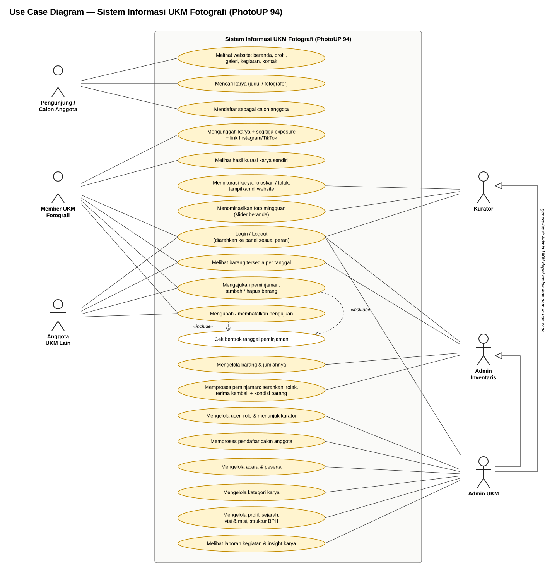
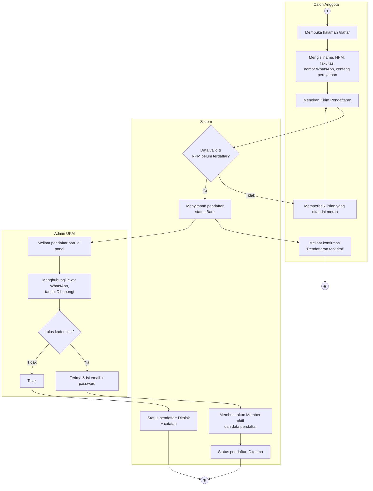
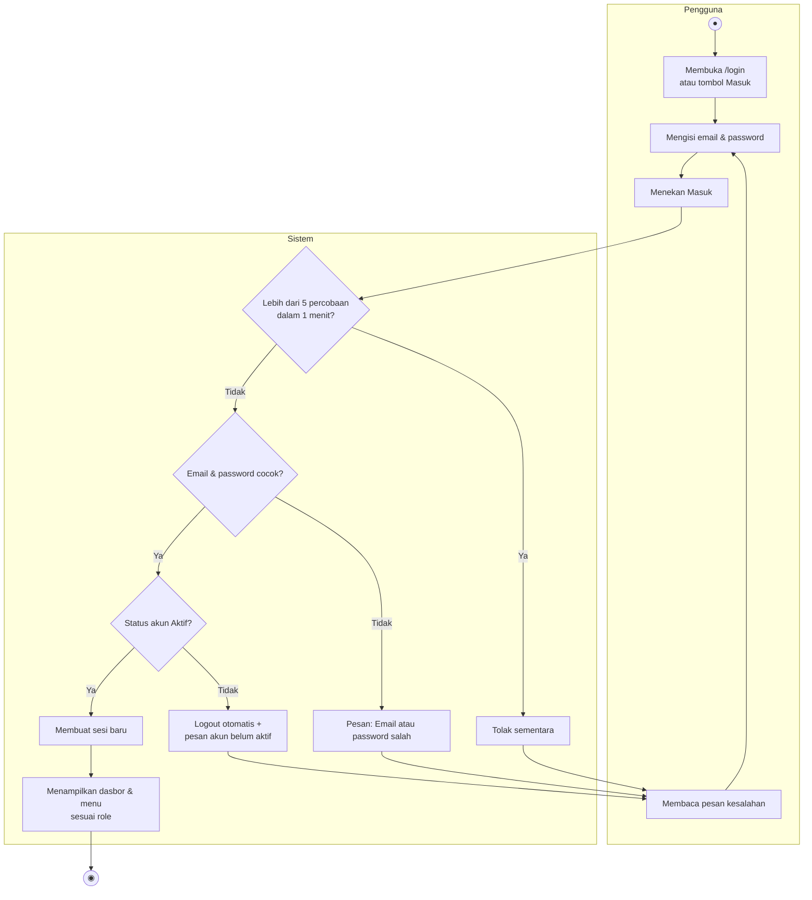
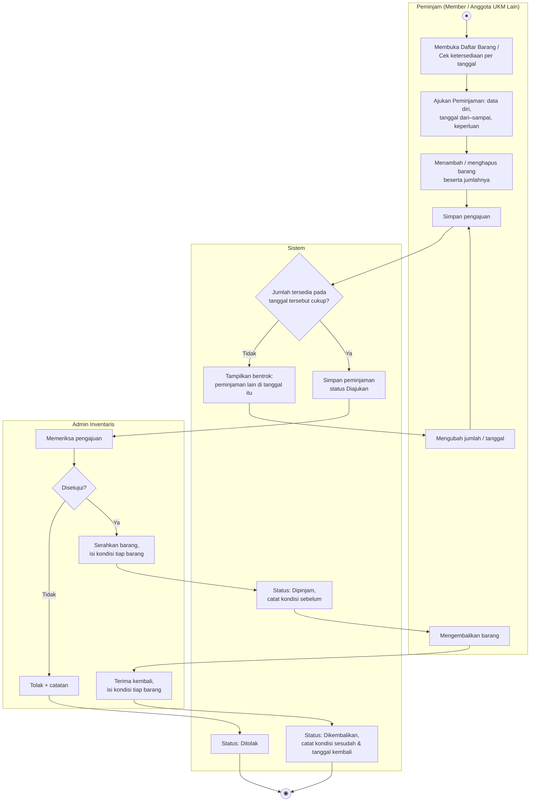
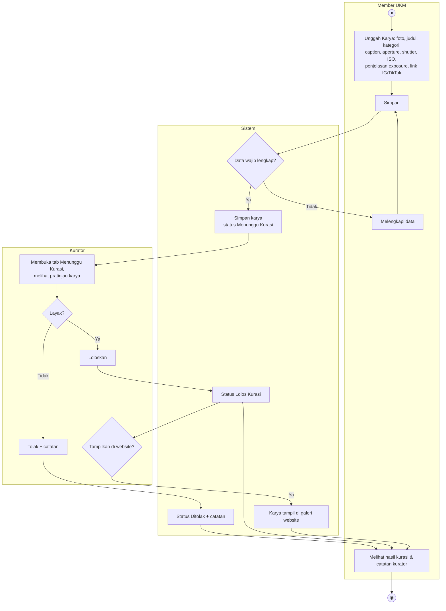
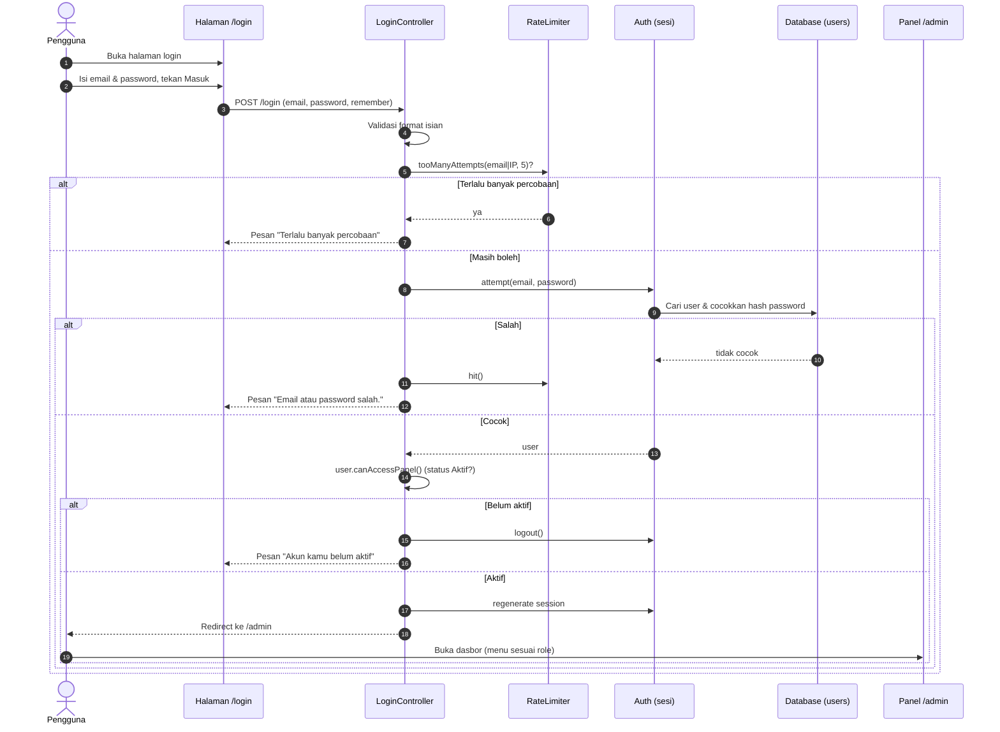
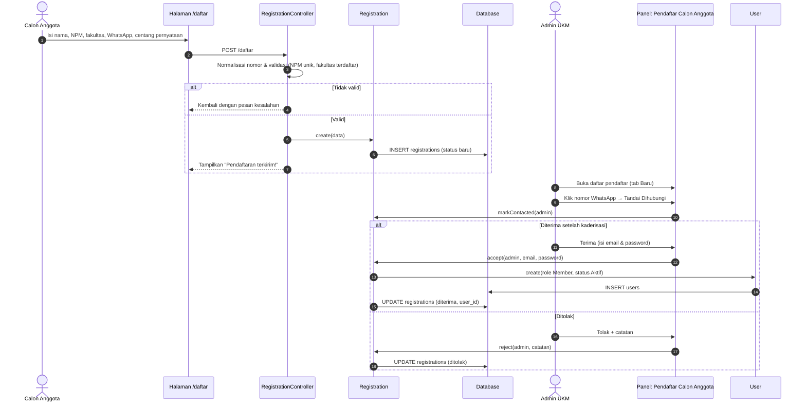
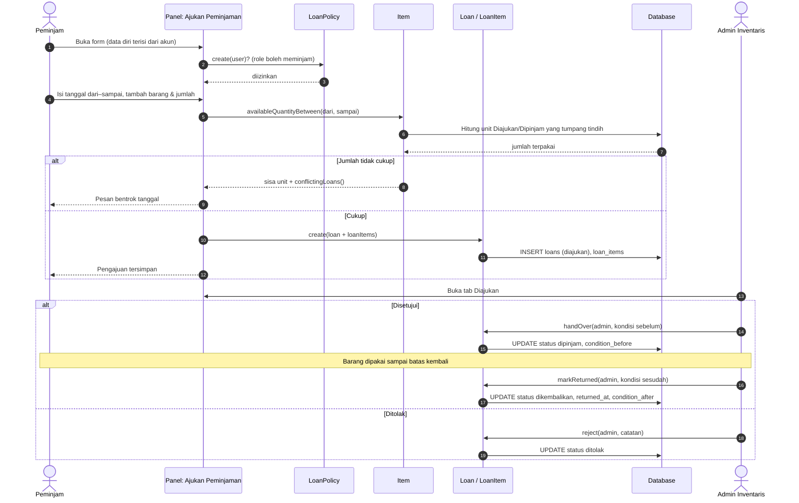
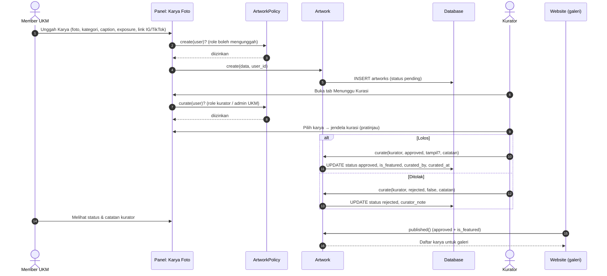
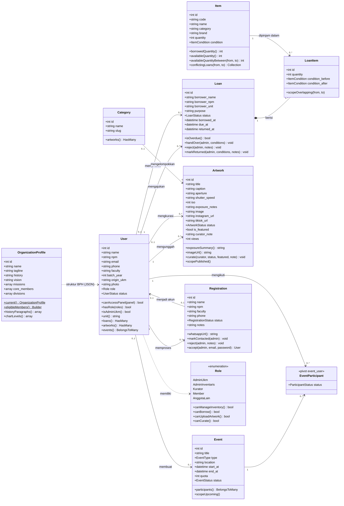

# UML — Sistem Informasi UKM Fotografi Universitas Pancasila (PhotoUP 94)

Diagram dibuat dari kode aplikasi (model, policy, controller, dan halaman panel Filament).
Versi gambar ada di folder [`uml/`](uml/) dan semuanya digabung di [`uml.pdf`](uml.pdf).

| No | Diagram | Gambar |
|---|---|---|
| 1 | Use Case Diagram | `uml/01-use-case.svg`, `uml/01-use-case.png` |
| 2 | Activity Diagram — Pendaftaran Calon Anggota | `uml/02-activity-pendaftaran.png` |
| 3 | Activity Diagram — Login | `uml/03-activity-login.png` |
| 4 | Activity Diagram — Peminjaman Barang | `uml/04-activity-peminjaman.png` |
| 5 | Activity Diagram — Unggah & Kurasi Karya | `uml/05-activity-kurasi.png` |
| 6 | Sequence Diagram — Login | `uml/06-sequence-login.png` |
| 7 | Sequence Diagram — Pendaftaran Calon Anggota | `uml/07-sequence-pendaftaran.png` |
| 8 | Sequence Diagram — Pengajuan & Proses Peminjaman | `uml/08-sequence-peminjaman.png` |
| 9 | Sequence Diagram — Unggah & Kurasi Karya | `uml/09-sequence-kurasi.png` |
| 10 | Class Diagram | `uml/10-class.png` |

## 1. Use Case Diagram

Aktor: **Pengunjung** (termasuk calon anggota), **Member UKM Fotografi**, **Anggota UKM Lain**, **Kurator**,
**Admin Inventaris**, dan **Admin UKM**. Admin UKM dapat melakukan semua use case aktor lain
(digambar sebagai generalisasi ke Admin Inventaris dan Kurator, dan ditulis pada label aktornya). Semua use case di panel mensyaratkan Login.

Ringkasan use case per aktor:

| Aktor | Use case |
|---|---|
| Pengunjung / Calon Anggota | Melihat website; mendaftar sebagai calon anggota |
| Member UKM Fotografi | Login/Logout; mengunggah karya; melihat hasil kurasi; melihat barang tersedia; mengajukan, mengubah, atau membatalkan peminjaman |
| Anggota UKM Lain | Login/Logout; melihat barang tersedia; mengajukan, mengubah, atau membatalkan peminjaman |
| Kurator | Login/Logout; mengkurasi karya |
| Admin Inventaris | Login/Logout; melihat barang tersedia; mengelola barang; memproses peminjaman |
| Admin UKM | Semua use case di atas (generalisasi), ditambah mengelola user & kurator, memproses pendaftar, mengelola acara, kategori, profil & struktur BPH, serta melihat laporan |

Mengajukan dan mengubah peminjaman selalu menyertakan (*include*) pengecekan bentrok tanggal.

## 2. Activity Diagram — Pendaftaran Calon Anggota

<!-- uml:02-activity-pendaftaran -->

## 3. Activity Diagram — Login

<!-- uml:03-activity-login -->

## 4. Activity Diagram — Peminjaman Barang

<!-- uml:04-activity-peminjaman -->

## 5. Activity Diagram — Unggah & Kurasi Karya

<!-- uml:05-activity-kurasi -->

## 6. Sequence Diagram — Login

<!-- uml:06-sequence-login -->

## 7. Sequence Diagram — Pendaftaran Calon Anggota

<!-- uml:07-sequence-pendaftaran -->

## 8. Sequence Diagram — Pengajuan & Proses Peminjaman

<!-- uml:08-sequence-peminjaman -->

## 9. Sequence Diagram — Unggah & Kurasi Karya

<!-- uml:09-sequence-kurasi -->

## 10. Class Diagram

<!-- uml:10-class -->

